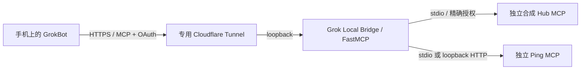

# Grok Local Bridge

在手机上对 GrokBot 说“读取我电脑上已授权服务的状态”。GrokBot 通过一个远程 HTTPS MCP 连接，经 OAuth 授权后调用 Windows 本地 MCP，再把结果返回给你。

本项目提供这个连接入口。它不会自动获得你电脑的全部权限；只有你明确添加的 MCP 后端和工具可以被调用。

**v0.1.0-alpha · Experimental · Windows x64 / Python 3.13**

[English](README_EN.md) · [架构与选型](docs/architecture.md) · [安全边界](docs/security.md) · [故障诊断](docs/troubleshooting.md) · [验收范围](docs/validation.md)

## 当前能做什么

- 将多个独立的 stdio / loopback Streamable HTTP MCP 组合成一个 OAuth 保护的入口，工具带命名空间。
- 复用 FastMCP 组合与代理；支持 PKCE S256、动态客户端注册、10 分钟 access token、7 天绝对有效期的可轮换 refresh grant。
- 精确工具及静态资源白名单；直接 tools/call 也要检查权限。默认每工具每分钟 60 次；另有入口请求总量限制。
- Windows CurrentUser DPAPI 保存本地配对码与后端秘密；默认不向后端转发客户端 Authorization Header 或整个环境变量。
- 从本地增删后端并热重载，不更换当前 OAuth 服务。支持受控 Gateway 恢复与停止自有进程。
- 内置两独立进程的合成示例：Attention Router 形状的只读状态与 Ping。**不依赖 Attention Router、ESP32 或私人 Hub。**

**未实现/未承诺：** 任意文件、Shell、硬件的内置通用操作，Windows 沙箱、每 Agent 独立 ACL、多用户托管、自动开机、系统重启恢复、长时间可用率与任意第三方 MCP 兼容。工作流可接入这些能力的可信 MCP，但各后端必须自己限制路径和参数。

历史 Grok MCP Connect 的合成双后端曾获真实 GrokBot 验收；本版本改名后是否完成真实客户端复测，以[当前验收记录](docs/validation.md)为准。WorkBuddy 的云端导入和 Windows 执行通道尚未验证，不能视为一键本地安装。

## 架构



Bridge 监听 `127.0.0.1`，仅公开 MCP 与必要 OAuth 路径，不提供远程管理接口。管理操作只在本机进行。

## 最快开始

需要 Windows x64、Python 3.13、PowerShell 5.1，以及到 PyPI、GitHub Releases 和 Cloudflare 的出站网络。从本仓库 Release 下载源码 ZIP，解压后进入 `grok-local-bridge`。没有 Python 时可使用安装器的 `-InstallMissingPython`，这会调用官方 winget 安装；此分支未在本轮已装 Python 的主机上实测。

```powershell
$installRoot = Join-Path $env:LOCALAPPDATA 'Grok Local Bridge'
.\scripts\install.ps1 -CheckOnly
.\scripts\install.ps1 -InstallDir $installRoot
$manage = Join-Path $installRoot 'scripts\connect.ps1'
& $manage -InstallDir $installRoot -CommandArgs @('doctor')
& $manage -InstallDir $installRoot -CommandArgs @('demo')
& $manage -InstallDir $installRoot -CommandArgs @('verify')
```

安装器创建独立 venv、安装锁定依赖、校验官方 cloudflared 2026.10.0 SHA-256、初始化独立状态；**安装不会启动公网服务**。拒绝覆盖已有安装。`demo` 只适用于空后端配置；`verify` 实际调用两个独立合成 MCP，成功仅代表本地协议验收。

准备公开这些合成只读工具时，执行：

```powershell
& $manage -InstallDir $installRoot -CommandArgs @('start')
& $manage -InstallDir $installRoot -CommandArgs @('status')
& $manage -InstallDir $installRoot -CommandArgs @('owner')
```

`start` 创建属于该安装的 Quick Tunnel，默认最多运行 120 分钟；`status` 的 `mcp_url` 是本次连接地址。`READY_LOCAL_AUTH_BOUNDARY` 只代表本地进程和认证边界就绪，尚不代表公网或 GrokBot 成功。`owner` 在本机窗口显示本次配对码，不要发到聊天或写入命令行。

### 连接 GrokBot

1. 添加远程 MCP，填写本次 `mcp_url`，选择 Streamable HTTP / OAuth。
2. 在授权页输入本机窗口的配对码并 Allow；如出现完成页，点击 Continue。回调必须属于代码中明确审核过的集合。
3. 刷新该连接的完整工具目录；要求 GrokBot **实际调用** `hub_get_hub_state` 和 `probe_ping`，不使用 Shell 模拟。
4. 两个结果都应包含 `provenance: SYNTHETIC`，Ping 返回 `pong`。不要把模型口述或仅发现工具当成实际调用。

客户端 Allow 是用户操作。Quick Tunnel 每次重建可能换地址，旧地址及旧 OAuth 注册不能直接沿用；稳定域名的 Named Tunnel 仅提供本地配置能力，外部验收另计。

### 关闭与恢复

```powershell
& $manage -InstallDir $installRoot -CommandArgs @('stop')
& $manage -InstallDir $installRoot -CommandArgs @('status')
# 需要恢复当前 Gateway 时：
& $manage -InstallDir $installRoot -CommandArgs @('recover')
```

`stop` 关闭本安装拥有的 Tunnel、Gateway 和其子进程，不按全局进程名杀程序，也不停止独立部署的外部 MCP。停止后认证入口应不可达。停止不等于永久撤销所有持久授权；同一稳定 origin 再启动时 refresh grant 可能仍有效。OAuth 客户端可用 `/revoke` 撤销自己的 grant；Quick origin 改变需重连授权。未完成的授权页在重启后失效。

## 添加或移除 MCP

参考 [stdio 配置](examples/stdio.backend.json) 与 [HTTP 配置](examples/http.backend.json)，在本地填写可信 MCP 的启动命令或 literal loopback HTTP 地址，逐个列出允许的工具。仅发现工具也会执行该后端代码，先确认来源。

```powershell
& $manage -InstallDir $installRoot -CommandArgs @('probe','--spec','C:\path\to\backend.json')
& $manage -InstallDir $installRoot -CommandArgs @('add','--spec','C:\path\to\backend.json')
& $manage -InstallDir $installRoot -CommandArgs @('status')
# 删除一个命名空间及其全部授权：
& $manage -InstallDir $installRoot -CommandArgs @('remove','--name','extra')
```

配置约 0.5 秒内重载，检查 `configuration.result = APPLIED` 和预期工具数量，再刷新客户端目录。删除后新请求被拒绝，已经执行中的调用可能完成；客户端缓存的旧名字不代表仍获授权。无效配置关闭所有工具，修复后自动重载。后端离线时完整目录查询会报错，避免缓存不完整目录；已知名字的健康后端仍可调用。stdio 代理每次请求建立独立子进程，**不保证后端进程内会话状态持续存在**。

默认是 read；高风险工具需配置对应 `write`、`delete`、`exec`、`hardware` 权限并在 add 时显式提供相应 `--permission`。这些标签不是沙箱。秘密通过 `secret --name SLOT` 在本机遮罩窗口输入，JSON 只保存槽位引用；不要在参数中放 Token。所有获准 OAuth 客户端共享本安装的工具授权。

## 安全与诊断

先阅读 [安全说明](docs/security.md)。Tunnel 不替代 OAuth；未经认证的 `/mcp` 必须返回 401，无效 Token 与未授权工具必须被拒绝。请求/工具限流和脱敏事件不等于完整业务审计或多租户隔离。

`diagnose` 会做本地与当前公网的 HTTP 健康探测，不会调用业务工具；若只需读状态，用 `status`。不要通过关闭 OAuth、修改 DNS/防火墙/代理来掩盖连接失败。日志不含请求参数和结果；不要上传 `.runtime`、DPAPI、数据库、原始日志或私人会话。

## 开发与路线

```powershell
python -m venv .venv
.\.venv\Scripts\python.exe -m pip install -r requirements.lock
.\.venv\Scripts\python.exe -m pip install --no-deps -e .
.\.venv\Scripts\python.exe -m pytest -q
.\.venv\Scripts\python.exe scripts\release_check.py
```

CI 使用 Windows、合成后端和假 Tunnel，无需账号秘密。首次安装依赖需要网络；测试本身不创建公网连接。验收范围见 [validation.md](docs/validation.md)。

下一步优先：干净 Windows VM 复现、改名版本真实 GrokBot 回归、稳定 origin 的外部恢复测试。没有承诺通用设备或任意程序适配器的完成时间。

## 来源、贡献与许可证

作者：**Tkkdy**。原创 Bridge 采用 [MIT](LICENSE)。改造自 Attention Router 的 OAuth、持久授权、DPAPI 源码保留 MIT 版权；FastMCP 使用 Apache-2.0，MCP SDK 使用 MIT，作为依赖安装。没有捆绑 Attention Router 的 GPL 固件或私人业务数据；详见 [第三方声明](THIRD_PARTY_NOTICES.md)。

欢迎按 [贡献指南](CONTRIBUTING.md) 提交可复现问题和小范围 PR；安全问题见 [SECURITY.md](SECURITY.md)。本项目为实验性社区项目，与 GrokBot、Cursor、xAI 或 Cloudflare 无官方隶属关系。
