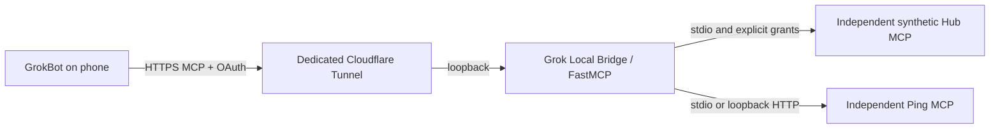

# Grok Local Bridge

Ask GrokBot on your phone to read an approved service on your Windows computer. GrokBot uses one remote HTTPS MCP connection, completes OAuth, calls the local MCP, and returns the result.

This project supplies that connection. It does not grant unrestricted access to your computer: only configured backends and explicitly approved tools are available.

**v0.1.0-alpha · Experimental · Windows x64 / Python 3.13**

[中文](README.md) · [Architecture](docs/architecture.md) · [Security](docs/security.md) · [Troubleshooting](docs/troubleshooting.md) · [Validation](docs/validation.md)

## Implemented and outside scope

- One OAuth-protected endpoint aggregates independent stdio and loopback Streamable HTTP MCPs with namespaced tools, using pinned FastMCP composition/proxy.
- DCR, exact redirect allowlist, PKCE S256, owner consent, 10-minute access tokens and rotating refresh grants with a seven-day absolute lifetime.
- Exact tool/static-resource grants, enforced on direct calls and discovery. Default per-tool limit: 60/minute, plus ingress caps.
- Windows CurrentUser DPAPI for local pairing/backend secrets. Client Authorization headers and the whole environment are not automatically forwarded.
- Local backend add/remove, atomic config reload, owned Gateway recovery and shutdown.
- Two independent synthetic demo processes: read-only Attention Router-shaped state and Ping. **No Attention Router installation, private Hub or ESP32 is required.**

Not implemented or promised: built-in arbitrary file/Shell/hardware tools, Windows sandboxing, per-Agent ACL, multi-user hosting, autostart, OS-reboot recovery, uptime guarantees or universal MCP compatibility. Trusted downstream MCPs must enforce paths, parameters and side effects.

The predecessor Grok MCP Connect had historical real GrokBot acceptance with synthetic backends. See [current validation](docs/validation.md) for this renamed release; historical results are not current acceptance. WorkBuddy cloud import/local execution remains unverified.

## Architecture



The Bridge binds 127.0.0.1. Only MCP and required OAuth paths are public; administration stays local.

## Quick start

Requirements: Windows x64, full Python 3.13 with working Tcl/Tk (tkinter), PowerShell 5.1, outbound access to PyPI/GitHub Releases/Cloudflare. Download the source ZIP from Releases, extract it and enter `grok-local-bridge`. The installer can use `-InstallMissingPython` to invoke official winget; that branch was not tested on a Python-free machine.

```powershell
$installRoot = Join-Path $env:LOCALAPPDATA 'Grok Local Bridge'
./scripts/install.ps1 -InstallDir $installRoot -InstallMissingPython
$manage = Join-Path $installRoot 'scripts/connect.ps1'
& $manage -InstallDir $installRoot -CommandArgs @('doctor')
& $manage -InstallDir $installRoot -CommandArgs @('demo')
& $manage -InstallDir $installRoot -CommandArgs @('verify')
```

`-InstallMissingPython` invokes winget only if Python is missing. If winget is unavailable, install full Python 3.13 from python.org with Tcl/Tk selected. Optional preflight: `./scripts/install.ps1 -CheckOnly`. Missing Tcl/Tk now fails before installation; the NuGet portable distribution has no Tk and cannot run the desktop consent window.

The installer creates a separate venv, installs locked dependencies, verifies official cloudflared 2026.10.0 by SHA-256 and initializes separate state. It refuses to overwrite an existing installation. **Installation does not start public exposure.** `demo` requires empty backend config; `verify` actually calls both synthetic MCPs. A local PASS is not OAuth, HTTPS or Grok acceptance.

When ready to expose the synthetic read-only tools:

```powershell
& $manage -InstallDir $installRoot -CommandArgs @('start')
& $manage -InstallDir $installRoot -CommandArgs @('status')
& $manage -InstallDir $installRoot -CommandArgs @('owner')
```

`start` creates this installation's Quick Tunnel for at most 120 minutes by default. Use `mcp_url` from `status`. `READY_LOCAL_AUTH_BOUNDARY` proves local readiness only. `owner` displays the pairing code in a local Windows dialog: never paste it into chat or command arguments.

### Connect GrokBot

1. Add a remote MCP using the current `mcp_url`; select Streamable HTTP / OAuth.
2. Enter the pairing code from the local owner dialog, then Allow. If shown, click Continue. Redirects must match the reviewed allowlist.
3. Refresh the full connector namespace and ask GrokBot to actually call `hub_get_hub_state` and `probe_ping`, without Shell simulation.
4. Both results must say `provenance: SYNTHETIC`; Ping returns pong. Discovery/model narration alone is not invocation evidence.

OAuth Allow requires user action. A new Quick Tunnel may change origin and require reconnect/authorization. Named Tunnel has local configuration support; external acceptance is recorded separately.

### Stop/recover

```powershell
& $manage -InstallDir $installRoot -CommandArgs @('stop')
& $manage -InstallDir $installRoot -CommandArgs @('status')
& $manage -InstallDir $installRoot -CommandArgs @('recover')
```

Stop closes owned Tunnel/Gateway descendants, not all processes by name or separately hosted MCPs. The remote entry should become unreachable. Stop is not permanent revocation: a grant may remain usable if the same stable origin restarts. OAuth clients can revoke their own grant at `/revoke`. Changed Quick origins need authorization again; pending consent pages do not survive restart.

The first verified real-local capability recipe is [read-only file search and reading](docs/filesystem-readonly.md). It is an optional independent MCP with a separately approved directory.

## Add/remove capabilities

Use the [stdio](examples/stdio.backend.json) or [HTTP](examples/http.backend.json) template. Specify a trusted executable or literal loopback HTTP target and exact tools. Even discovery executes backend code; review its source first.

```powershell
& $manage -InstallDir $installRoot -CommandArgs @('probe','--spec','C:/path/to/backend.json')
& $manage -InstallDir $installRoot -CommandArgs @('add','--spec','C:/path/to/backend.json')
& $manage -InstallDir $installRoot -CommandArgs @('status')
& $manage -InstallDir $installRoot -CommandArgs @('remove','--name','extra')
```

Config is checked every 0.5 seconds. Wait for `configuration.result = APPLIED` and the expected tool count before refreshing clients. Removed grants deny new calls; an in-flight call may complete. Invalid config closes tools until corrected. When a backend fails, complete discovery errors to avoid silently caching a partial catalog; direct calls to known healthy tools still work. stdio uses a fresh process per request, so process-memory sessions do not persist.

Default permissions are read. Write/delete/exec/hardware require matching config permissions and explicit `--permission` flags on add; labels are not a sandbox. Use `secret --name SLOT` for local masked input and reference only slot names in JSON. All approved OAuth clients share this installation's tool grants.

## Safety and diagnosis

Read [security](docs/security.md). A Tunnel does not replace authentication. Unauthenticated MCP must return 401; invalid tokens and unauthorized direct calls must fail. Limits and sanitized events are not full business auditing or a multi-tenant boundary.

`diagnose` probes local/current-public HTTP health without business tool calls; `status` only reads local status. Never disable OAuth or change proxy/firewall/DNS policy to hide failure. Do not upload runtime state, DPAPI files, databases, raw logs or private conversations.

## Development and roadmap

```powershell
python -m venv .venv
./.venv/Scripts/python.exe -m pip install -r requirements.lock
./.venv/Scripts/python.exe -m pip install --no-deps -e .
./.venv/Scripts/python.exe -m pytest -q
./.venv/Scripts/python.exe scripts/release_check.py
```

Windows CI uses synthetic backends and a fake Tunnel, with no account secrets. Installation needs network access; tests do not create public connections. Priorities: clean Windows VM reproduction, real GrokBot regression for the renamed release, then external stable-origin recovery. No delivery date is promised for arbitrary software/device adapters.

## Attribution, contribution, license

Author: Tkkdy. Original Bridge code is [MIT](LICENSE). Attention Router OAuth/persistence/DPAPI retains MIT notices. FastMCP is Apache-2.0 and MCP SDK is MIT, installed as dependencies. No GPL firmware/private AR business data is bundled. See [third-party notices](THIRD_PARTY_NOTICES.md), [contributing](CONTRIBUTING.md) and [security reporting](SECURITY.md).

This experimental community project is not affiliated with GrokBot, Cursor, xAI or Cloudflare.
